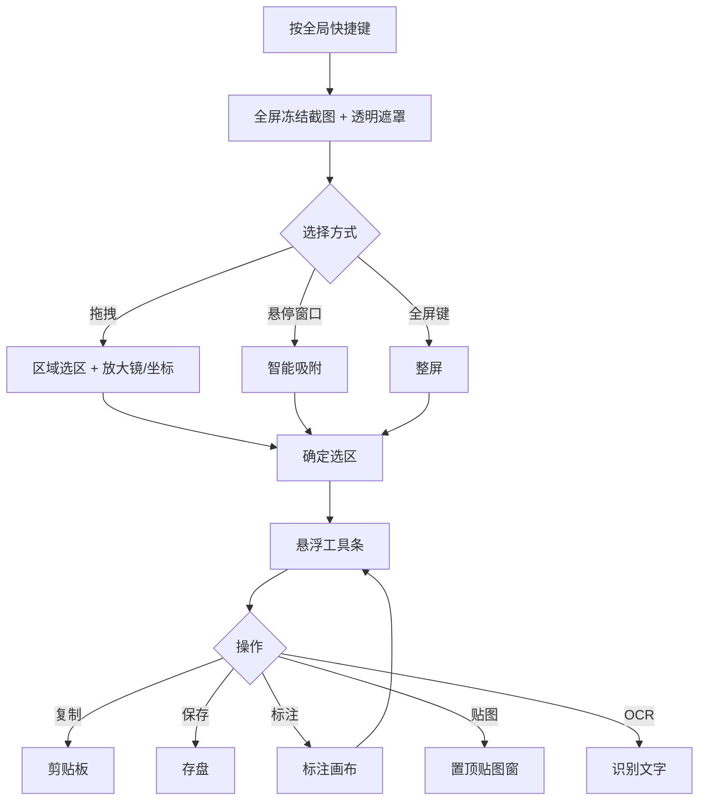
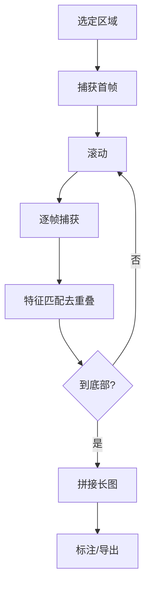
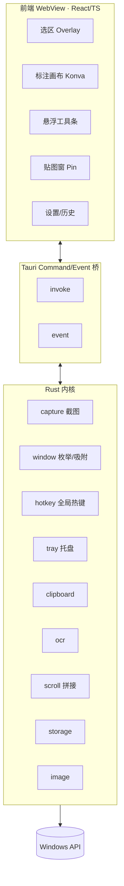

# Snapix — 全能 Windows 截图工具 · 设计文档

> 定位：像 CleanShot X 一样顺滑、像 Shottr 一样轻快、对中文/国内场景友好的 Windows 全能截图工具。
> 技术栈：Tauri 2（Rust 内核 + Web 标注层）。

---

## 1. 竞品分析速览

| 软件 | 优势 | 不足 |
| --- | --- | --- |
| macOS 自带截图 | 系统级集成、放大镜、悬浮缩略图即时操作 | 标注基础、无 OCR/贴图/长截图 |
| CleanShot X | 滚动截图、出图美化、OCR、贴图、步骤序号标注 | 付费偏贵、依赖云、功能多有学习成本 |
| Shottr | 极轻量、滚动截图、OCR、测量取色 | UI 偏极客、协作弱 |
| Snagit | 专业标注与模板、跨平台 | 重、启动慢、贵 |
| Xnapper | 一键美化、自动打码、社媒预设 | 场景单一 |

**机会点**：Windows 缺少一个体验顺滑、轻快、中文友好的全能工具。Snipaste（贴图强）、ShareX（功能多但 UI 劝退）、PixPin 各有侧重。

---

## 2. 功能清单（按优先级）

### A. 捕获 Capture
- P0 区域截图（放大镜 / 像素坐标 / 取色）
- P0 智能窗口/控件吸附
- P0 全屏截图、多显示器 + 高 DPI
- P1 指定窗口截图、滚动长截图、延时截图
- P2 重复上次区域、录屏 / GIF

### B. 标注 Annotate
- P0 箭头/直线/矩形/圆/画笔、文字、马赛克+模糊、步骤序号、撤销重做（对象图层化）
- P1 高亮聚光灯、裁剪旋转
- P2 自动隐私打码

### C. 出图美化 Beautify（差异化）
- P1 背景衬底（纯色/渐变/壁纸）、阴影、圆角、内边距
- P2 窗口拟态边框、社媒尺寸预设、水印

### D. 输出与管理 Output
- P0 自动复制到剪贴板、保存（PNG/JPG/WebP）+ 命名模板
- P1 贴图置顶、OCR、历史记录面板
- P2 云上传 + 短链

### E. 系统集成 System
- P0 全局快捷键、系统托盘、截图后悬浮工具条、设置中心
- P2 自动更新

---

## 3. 核心交互流程

### 主截图流程


### 滚动长截图


---

## 4. 架构设计

### 进程 / 模块分层


### 多窗口
- `main`：首页/仪表盘（无边框 + 自定义标题栏）
- `overlay`：透明全屏遮罩，用于选区（置顶、无边框、跳过任务栏）
- `editor`：标注 / 美化编辑器（后续阶段）
- `pin-{id}`：每张贴图一个无边框置顶窗（后续阶段）
- `settings` / `history`：管理界面（后续阶段）

### 关键决策
- 截图内核在 Rust 侧（`xcap`，多屏 / 高 DPI 物理像素）；窗口 / 控件吸附用 `windows-rs`（DWM 可视边界 + UI Automation）。
- 标注层在前端用 Canvas + Konva.js（对象化图层、命中检测、变换框）。
- 大位图不走 IPC：Rust 持有 `RgbaImage`，前端通过自定义协议 `shot://` 拉取零压缩 BMP（含半透明像素时用带 alpha 掩码的 V4 头）；只有编辑器导出成图走 data URL。
- DPI/多屏统一在 Rust 侧取物理像素 + scale factor。
- 线程模型：同步 Tauri 命令运行在主 UI 线程，所有可能耗时的命令（文件对话框、OCR、二维码、大图编解码、UIA）都是 `async fn` 并下放到阻塞线程池（`util::blocking`）；托盘 / 全局快捷键回调复用同名 `*_impl` 同步函数。
- 安全基线：生产 CSP 只放行自身源与 `shot://`；`shot://` 响应仅对应用自身 origin 开放 CORS；不暴露 `window.__TAURI__`；所有按 id 定位文件的历史命令统一校验 id。

### 技术栈
| 层 | 选型 |
| --- | --- |
| 框架 | Tauri 2.x |
| 后端 | Rust |
| 截图 | xcap（抓屏）+ windows-rs（窗口枚举 / UIA / 滚轮注入） |
| 全局热键 | tauri-plugin-global-shortcut |
| 图像 | image crate（PNG/JPEG）、gif crate（GIF 编码）、rqrr（二维码） |
| OCR | Windows.Media.Ocr（系统内置引擎，超尺寸自动缩放 / 分片） |
| 前端 | React 19 + TypeScript + Vite |
| 标注 | Konva.js / react-konva |
| 样式 | Tailwind CSS v4 + 自定义设计 token |
| 状态 | Zustand |
| 动效 | Motion (framer-motion) |
| 图标 | lucide-react |
| 存储 | `appconfig/settings.json`（配置）+ `appdata/history/index.json` + PNG/缩略图（历史），均原子写入 |
| 打包/更新 | Tauri bundler（NSIS / MSI）；自动更新与签名待接入 |

---

## 5. UI 设计规范

- 风格：现代极简 + 轻拟物，深色优先，玻璃质感（backdrop-blur + 细边框 + 柔和多层阴影）。
- 强调色：靛蓝 `#5B6CFF`（`brand-500`），中性灰 `ink` 色阶。
- 圆角：工具条 14px / 面板 16px / 按钮 10px / 贴图 10px。
- 间距：8pt 栅格。
- 字体：Inter + 思源黑体 / 系统中文字体。
- 动效：过渡 ≤ 200ms，缓动 `cubic-bezier(0.22, 1, 0.36, 1)`。
- 键盘优先：Esc 取消、Enter 确认、数字切工具、Ctrl+C/S。

设计 token 实现见 `src/styles/globals.css` 的 `@theme`。

---

## 6. 目录结构
```text
snapix/
├─ src-tauri/            # Rust 内核
│  ├─ src/lib.rs         # 入口、shot:// 协议、托盘、全局热键、窗口关闭拦截
│  ├─ src/capture.rs     # 冻屏 / 裁剪 / 复制保存 / 编辑器 / 贴图分发
│  ├─ src/scroll.rs      # 滚动长截图（拼接引擎 + 会话）
│  ├─ src/gifrec.rs      # GIF 录屏
│  ├─ src/ocr.rs         # Windows OCR + 隐私定位
│  ├─ src/snap.rs        # 窗口吸附（EnumWindows + DWM）
│  ├─ src/uia.rs         # 控件吸附（UI Automation）
│  ├─ src/history.rs     # 历史记录（索引 + 缩略图）
│  ├─ src/settings.rs    # 设置中心（快捷键注册 / 命名模板）
│  ├─ src/util.rs        # 毒化安全锁 / 原子写文件 / 阻塞任务下放
│  ├─ capabilities/      # 权限（main / overlay-* / editor / pin-* / scroll-* / gif-*）
│  └─ tauri.conf.json    # 多窗口 + CSP 配置
├─ src/
│  ├─ windows/           # Home / Overlay / Editor / Pin / Scroll / Gif
│  ├─ features/          # annotate（Konva 画布 / store / 美化）、home（历史 / 设置面板）
│  ├─ components/        # TitleBar 等通用组件
│  ├─ lib/               # ipc.ts / cn.ts
│  └─ styles/globals.css # 设计 token
├─ *.html                # 各窗口入口（index / overlay / editor / pin / scroll / gif）
└─ docs/                 # DESIGN.md / PLAN.md / TESTING.md
```
