# Snapix 开发计划

按阶段推进，每阶段有明确产出。✅ 已完成 / 🔄 进行中 / ⬜ 待办。

```mermaid
gantt
    title Snapix 路线
    dateFormat X
    axisFormat %s
    section 阶段0 脚手架
    项目初始化 :0, 1
    section 阶段1 MVP截图
    截图内核+选区+输出 :1, 3
    section 阶段2 标注
    标注画布体系 :3, 2
    section 阶段3 进阶
    贴图/长截图/OCR :5, 3
    section 阶段4 美化
    出图美化 :8, 2
    section 阶段5 打磨
    历史/设置/动效/打包 :10, 2
```

---

## 阶段 0 · 脚手架与基建（约 1 周）

**目标**：按快捷键能弹出透明全屏遮罩窗，奠定多窗口 + 设计系统基础。

- ✅ 初始化 Tauri 2 + React + TS + Vite
- ✅ 接入 Tailwind v4 + 设计 token（深色玻璃拟态）
- ✅ 依赖：zustand / motion / lucide-react / global-shortcut
- ✅ 多窗口配置：`main`（无边框自定义标题栏）+ `overlay`（透明全屏置顶）
- ✅ Rust：全局快捷键 `Ctrl+Shift+A` → 定位光标所在显示器并显示遮罩
- ✅ 前端：首页仪表盘 + 遮罩选区交互（拖拽选区、尺寸标签、悬浮工具条占位、Esc 取消）
- ✅ 文档：`docs/DESIGN.md`、`docs/PLAN.md`

**产出**：可运行的骨架，截图主路径的「唤起 → 选区 → 工具条」交互已成形（尚未捕获真实像素）。

---

## 阶段 1 · MVP 截图主链路（约 2–3 周）· P0

**目标**：完成「截图 → 复制/保存」完整闭环，这一版就要好用。

- ✅ Rust 截图内核：集成 `xcap`，多屏 / 高 DPI 物理像素捕获（光标所在屏「冻屏」）
- ✅ 捕获整屏像素存入状态，冻屏图以 base64 回传前端做选区背景
- ✅ 选区裁剪：物理像素坐标换算 + 边界夹紧
- ✅ 选区增强：放大镜、像素级坐标、RGB 取色（离屏 canvas 采样）
- ✅ 剪贴板写入图片（`tauri-plugin-clipboard-manager`，Rust 侧）
- ✅ 保存：保存对话框 + 写入 PNG/JPG（`tauri-plugin-dialog`）
- ✅ 系统托盘 + 菜单（截图 / 打开主窗口 / 退出），关闭主窗口收进托盘
- ✅ 悬浮工具条接通「复制 / 保存 / 取消 / 完成」
- ⬜ Rust 窗口枚举 + 智能窗口/控件吸附高亮（顺延）
- ⬜ 保存命名模板（日期/序号）+ 默认保存路径设置（顺延至设置中心）
- ⬜ 开机自启（顺延至设置中心）

**产出**：日常可用的截图工具 v0.2 —— 截图、放大镜取色、复制到剪贴板、另存为文件、托盘常驻。

---

## 阶段 2 · 标注体系（约 2 周）· P0

**目标**：完整标注能力，能直接出教程图。

- ✅ 新增 `editor` 窗 + Konva 画布（react-konva，适配窗口缩放显示）
- ✅ 工具：箭头 / 直线 / 矩形 / 椭圆 / 画笔 / 文字
- ✅ 马赛克（Pixelate）+ 模糊（Blur）区域
- ✅ 步骤序号标注（自动递增）
- ✅ 对象图层化：选中 / 拖拽移动 / 缩放（矩形·马赛克·模糊）/ 删除
- ✅ 撤销 / 重做（历史栈，Ctrl+Z / Ctrl+Y）
- ✅ 属性面板：调色板 / 线宽 / 字号
- ✅ 标注结果导出：全分辨率渲染 → 复制到剪贴板 / 另存为文件
- ⬜ 文字框自动换行宽度拖拽、椭圆/箭头缩放手柄（增强，顺延）

**产出**：标注出图能力对齐主流工具 —— 截图后点「标注」进入编辑器，画箭头/框/序号/打码/写字，复制或保存。

---

## 阶段 3 · 进阶捕获与生产力（约 3 周）· P1

**目标**：与 Snipaste / Shottr 拉开身位。

- ✅ 贴图置顶：`pin-{n}` 无边框置顶窗，原位生成、拖动、滚轮缩放、复制、双击/按钮关闭、多窗管理
- ✅ 离线 OCR：Windows.Media.Ocr 内置引擎（原生中文，无需打包模型），结果面板可复制
- ⬜ 滚动长截图：滚动捕获 + 图像拼接去重叠（技术风险高，单独迭代）
- ⬜ 延时截图、重复上次区域（顺延）

**产出**：贴图置顶 + 离线文字识别成型，截图工具条「贴图 / OCR」已点亮。

---

## 阶段 4 · 出图美化（约 2 周）· 差异化

**目标**：一键出「好看的图」，对标 CleanShot / Xnapper。

- ✅ 背景衬底：纯色 / 渐变（9 套预设，含透明）
- ✅ 阴影 + 圆角 + 内边距（实时 CSS 预览）
- ✅ 社媒尺寸预设（自动 / 1:1 / 16:9 / 4:3 / 9:16）
- ✅ 水印文字（右下角，导出合成）
- ⬜ 壁纸图背景（需内置素材，后续补）
- ⬜ 自动隐私打码（手机号 / 邮箱 / 身份证识别，依赖 OCR 词框，单独迭代）

**实现要点**：纯前端方案——编辑器内用 CSS 框层实时预览（背景/边距/圆角/阴影/水印），导出时用离屏 `<canvas>` 合成全分辨率成图（`computeLayout` + `paintBackground` + `roundRectPath`），标注坐标系不受影响，复用既有 `copy_image` / `save_image` 命令。

**产出**：高溢价美化能力（背景、边距、圆角、投影、画幅比例、水印）已成型，编辑器顶栏「美化」按钮点亮右侧面板。

---

## 阶段 5 · v0.3 核心体验升级（本轮）· P0

**目标**：把「截图主链路」打磨到对齐 Snipaste / PixPin 的丝滑度，并补齐产品化基建（设置 / 历史）。

### 5.1 性能与流畅
- ✅ `shot://` 自定义协议直出 BMP 冻屏帧（替代 PNG 编码 + base64 IPC，4K 唤起从数百 ms 降至几十 ms）
- ✅ 前端图像加载完成 ack 后再显示遮罩窗，消除旧帧闪烁
- ✅ 编辑器 / 贴图图像统一走协议（不再传 base64）
- ✅ 跨 DPI 显示器几何防御：选区坐标系以冻屏帧为准 + 显示后重断言窗口几何

### 5.2 捕获体验
- ✅ 智能窗口吸附：Rust `EnumWindows` + `DWMWA_EXTENDED_FRAME_BOUNDS` 按 z 序枚举可见窗口，悬停高亮、单击选中
- ✅ 选区可编辑：拖动移动、8 手柄 + 4 边缩放、方向键微调（Ctrl+方向键调大小、Shift 步进 10px）
- ✅ 调整选区时放大镜跟随（像素级对边）
- ✅ 键鼠全操作：Enter / 双击 = 复制完成；右键 = 回退选区 / 退出；Ctrl+A 全屏；C 复制取色值；Ctrl+C/S/T/E 复制/保存/贴图/标注
- ✅ 延时截图（3s / 5s / 10s，托盘 + 主页）
- ✅ 重复上次区域（托盘 / 主页 / 可配快捷键，预选上次区域可再调整）

### 5.3 设置中心（Rust `settings.json` 单一数据源）
- ✅ 快捷键自定义（截图 / 重复上次，动态重注册；录制期间自动挂起全局热键）
- ✅ 保存目录 + 文件命名模板（`{date}` `{time}` `{w}` `{h}`）+ 格式（PNG/JPG）
- ✅ 保存方式（每次询问 / 直接保存默认目录）、保存后同时复制
- ✅ 开机自启（tauri-plugin-autostart）
- ✅ 历史记录开关与容量上限

### 5.4 历史记录
- ✅ 所有产出（复制/保存/贴图/标注导出）自动落盘 `appdata/history` + `index.json`（后台线程编码不阻塞主链路）
- ✅ 主窗历史面板：缩略图网格、复制 / 贴图 / 再编辑 / 另存 / 删除 / 清空 / 打开目录

### 5.5 贴图与编辑器增强
- ✅ 贴图：Ctrl+滚轮透明度、缩放/透明度 HUD、右键菜单（复制/另存/重置/关闭）、Esc/双击关闭、Ctrl+C/S、0 重置
- ✅ 编辑器：荧光笔（半透明高亮）、自定义颜色选择器、箭头/直线端点拖拽编辑
- ✅ 主窗改造：侧边栏（截图 / 历史 / 设置），托盘菜单扩充（延时 / 重复上次 / 历史 / 设置）

**产出**：日常主力可用的 v0.3 —— 快、稳、可配置、有历史。

---

## 阶段 6 · 进阶捕获 v0.4

- ✅ 滚动长截图 v1：选区 → SendInput 滚轮注入 → 行签名 SAD 匹配位移 → 增量拼接；
  粘性表头/表尾自动剔除、触底自动完成、控制条（完成/取消/进度）+ 穿透描边窗、
  区域高度自适应滚动力度、上限 24000px/150 帧，装配后直入编辑器（拼接引擎有单测）
- ✅ 控件级吸附：UIA `ElementFromPoint`（查询瞬间对遮罩加 `WS_EX_TRANSPARENT` 穿透自身），
  遮罩内 Tab 切换 窗口/元素 两级吸附，元素名 + 尺寸标签
- ✅ 多显示器同时遮罩：启动预创建每屏一个遮罩窗（overlay-N），全屏同时冻屏；
  选区/吸附/键盘各屏独立，交互屏 claim 后其余屏 standby 清选区，鼠标移入即接管键盘焦点；
  载荷带 label 校验 + 窗口作用域监听双保险防串扰
- ✅ 滚动截图 v2：横向滚动（Shift + 工具条按钮，转置复用纵向拼接引擎，含单测）
- ✅ 截图附带光标选项（设置开关，冻屏帧内合成；全屏 / 窗口即拍同样生效）
- ✅ 滚动截图 v3：匹配失败不再静默收尾——连续三帧对不上自动暂停并把原因显示在控制条上
  （琥珀色提示 + 触底预警），空格暂停 / ↓ 逐帧步进 / Enter 完成；暂停 90s 无操作自动收尾，
  恢复时把滚轮目标窗口重新拉回前台；「没检测到滚动」「到达长度上限」落通知
- ⬜ 圆角窗口阴影裁剪

## 阶段 7 · 差异化补全 v0.5

- ✅ 自动隐私打码：编辑器「自动打码」——OCR 词框（过宽自动缩放 / 过高分片）+
  手机号/邮箱/身份证/银行卡正则（数字边界防误伤、跨词合并、区间去重）→ 批量马赛克（一次撤销可还原，纯逻辑有单测）
- ✅ 贴图组管理：剪贴板图片一键贴图（托盘 + 可配快捷键，贴在光标旁）、全部贴图一键隐藏/显示（托盘）
- ✅ 标注裁剪：非破坏式裁剪视口（Konva Stage offset 实现，标注坐标不变），
  裁剪 chip 一键还原，导出/美化按裁剪尺寸合成
- ✅ 出图美化补全：新增渐变（极光/暮色/糖果）+ 点阵/网格图案背景（CSS 预览与 canvas 导出双路径一致）、
  macOS 风格窗口拟态边框（浅/深标题栏 + 三色灯，标题栏与截图共用圆角投影；布局几何有校验）
- ✅ 标注：聚光灯、emoji 贴纸、旋转、测量标尺（v0.6 完成）

## 阶段 9 · 对标补全 v0.6

对照 Snipaste / PixPin / CleanShot X / Snagit 补齐旗舰能力：

- ✅ 全屏即拍：可配快捷键 + 托盘 + 主页入口，截取光标所在屏 → 剪贴板（「直接保存」模式同时静默存盘），零交互
- ✅ 窗口即拍：可配快捷键，GetForegroundWindow + DWM 可视边界截取前台窗口（跨屏取中心屏交集），
  复制 + 通知（带窗口标题），零交互
- ✅ 编辑器连续出图：Shift+点击（或 Ctrl+Shift+C/S）复制/保存后不关闭，连续标注多图
- ✅ 统一测试清单：docs/TESTING.md（11 大类逐项勾选，新功能标注）
- ✅ GIF 录屏 v1：选区 → 工具条「录制 GIF」→ 穿透描边窗 + 控制条（Enter 停止 / Esc 取消 / 实时时长帧数），
  捕获线程 10fps 抓帧、编码线程增量写盘（有界队列积压丢帧保节奏，不涨内存），
  上限 60s、最长边 >1280px 等比缩小，停止后模板命名直存保存目录 + 资源管理器定位（尺寸夹紧有单测）
- ✅ 二维码识别：rqrr 离线解码（prepare_from_greyscale，免拖 image 全家桶），
  与 OCR 并行触发，结果面板顶部分区展示多个码、逐条复制
- ✅ 编辑器·聚光灯：压暗全图 + destination-out 挖亮选区（同层合成，导出一致），可多个、可拖拽/变换
- ✅ 编辑器·Emoji 贴纸：18 款预设，字号档位定初始大小，角点等比缩放
- ✅ 编辑器·标注旋转：矩形/椭圆/贴纸/文字支持旋转手柄（45° 吸附；文字仅旋转，字号走属性栏；
  马赛克/模糊/聚光灯为区域效果不旋转）
- ✅ 编辑器·测量标尺：两点拉线显示像素距离（端点刻度线 + 法线偏移标签，字号随图宽自适应），
  端点可拖拽微调，整体可移动
- ✅ 标注剪贴板图片：托盘「标注剪贴板图片」/ 主页快捷入口 / 编辑器 Ctrl+V，读剪贴板位图直入编辑器
- ✅ 系统通知：全屏即拍（复制/存盘结果）、GIF 保存完成（tauri-plugin-notification，Rust 侧静默失败）
- ✅ 编辑器·图形样式：矩形/椭圆「描边 / 填充（22% 半透明）」双模式；椭圆补缩放手柄；马赛克/模糊选中后强度滑杆
- ✅ 编辑器·操作效率：单键切换工具（V/R/O/A/L/P/H/T/N/E/F/M/B/C）、Ctrl+C/S 直接出图、
  Ctrl+滚轮画布缩放 + Ctrl+0/=/− 档位（长图/像素级打码友好）、Esc 取消选中/关闭、成图直接「贴图」
- ✅ 贴图窗：R 旋转 90°（Rust 侧改位图，复制/另存一致）、F 水平翻转、右键「标注」送回编辑器、
  鼠标穿透（set_ignore_cursor_events，托盘「解除贴图鼠标穿透」批量还原）
- ✅ 遮罩：Shift 拖拽/角点正方形约束、Shift+C 复制 RGB（C 复制 HEX）
- ✅ 设置：新增「全屏即拍」「隐藏/显示全部贴图」快捷键位（注册/校验循环化）
- ✅ 晾衣绳（v0.6）：产出图自动挂到屏幕顶部弧形绳上（透明置顶条窗 + SVG 麻绳 + 木夹），
  可沿绳拖动定位（带受力摇摆）、悬停复制/展开/取下、点开成贴图后双击飞回原位置；空白区整窗鼠标穿透；
  `WDA_EXCLUDEFROMCAPTURE` 不被拍进截图；工具窗样式不进 Alt+Tab 与窗口吸附；托盘 / 设置双开关
- ✅ 修复：保存对话框打开时遮罩被提前收起（改为对话框以遮罩为父窗，存盘成功才收；取消保留选区）；
  对话框期间 Esc 不再连带取消整个截图；编辑器取消保存不再关闭编辑器
- ✅ 修复：主页「滚动长截图」误标为未上线；长图编辑器滚动后文字编辑框错位；
  绘制工具落笔被已有图形（马赛克/聚光灯等大命中区）拦截
- ✅ 修复（v0.6.5）：点对勾后「落地弹跳」——绳窗忽略了 `line:changed` 的落地 id，
  飞行到位的那张又播了一遍 `line-drop` 入场动画；现在落地项不播入场，刷新也做了合并
- ✅ 修复（v0.6.6）：托盘图标仍是「白底方块」——托盘原先复用应用图标，而那一版带白贴纸描边，
  缩到 16px 时白边 + 奶油色机身填满整格。改为专用字形 `icons/tray-32.png`（透明底、深绿机身、
  奶油镜头），16px 下仍可辨认，深浅任务栏都成立
- ✅ 修复（v0.6.5）：点对勾偶发卡死、遮罩收不掉只能强杀——`hide()` 超时被静默忽略、
  收尾链路无上限等待且 committing 期间拦掉 Esc、`finish_flight` 先删 flight 导致超时兜底失效。
  现在：逐窗验证 + 后台重试、帧号断言、二次补刀命令（`overlay_release`）、前端 6s 兜底与
  Esc 逃生、幽灵遮罩可被下一次快捷键回收

## 阶段 8 · 发布 1.0

- ✅ 品牌图标（渐变取景框）+ 全套尺寸生成（tauri icon）
- ✅ 版本对齐 0.6.x，NSIS 安装包构建（当前 0.6.6）
- ✅ GIF 录屏（v0.6 完成；视频录屏 MP4 待评估）
- ✅ 动效打磨（晾衣绳落下 / 拖动）；✅ 亮色主题（主窗 + 编辑器，截图层恒定深色）；✅ 空状态（历史 / 筛选 / OCR 均有兜底文案）
- ✅ 自动更新（v0.6.2）：`tauri-plugin-updater` + GitHub Releases + minisign 签名校验；设置页手动检查 / 下载安装，启动静默检查
- ✅ 更新下载可取消（v0.6.4）：改为 `Update::download` + 可 abort 的异步任务，取消即断连
- 🔄 代码签名：脚本与 CI 已接好（`scripts/sign-windows.mjs` + `docs/SIGNING.md`），等证书到位
- 🔄 性能门槛：已加「快捷键 → 遮罩」日志与窗口状态记忆。内存排查（debug 版基线，主窗打开、
  未截图）：整组 7 个进程 WorkingSet 合计 ~409MB / 私有内存合计 ~274MB，其中 WebView2 的
  browser 进程 144MB + gpu 进程 75MB 就是运行时固定开销，150MB 目标对多窗 WebView2 架构不现实
  （release 实测约 235MB）。已落地的可控项：编辑器关闭 1.5s 后卸载 Konva 画布与解码位图、
  大图 BMP 改 no-store / 30s 缓存、遮罩收起即释放冻屏帧与取色画布

**产出**：Snapix 1.0。
